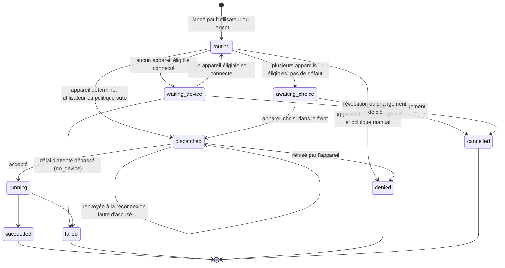

# Tower — Architecture

Tower est un médiateur self-hosted entre mes appareils. Il centralise les tâches (pro et
perso, séparées en workspaces), distribue des jobs aux appareils connectés, suit des outils
externes (Jira, merge requests) et déclenche, au fil des événements, un agent IA qui tient
les tâches à jour et lance des jobs.

## Vue d'ensemble

```
                ┌──────────────────── Tower (serveur) ─────────────────────┐
  Front Vue ──► │  API OpenAPI ──► Noyau : comptes, workspaces, tâches,    │
                │                  journal d'événements                    │
                │        │                 │                    │          │
                │        ▼                 ▼                    ▼          │
                │  Bus d'appareils    Intégrations         Agent IA        │
                │  (jobs, livraisons) (Jira, MR, diff)     (provider       │
                │                                           abstrait)      │
                └───────┬─────────────────┬────────────────────────────────┘
                        │ WebSocket        │ HTTPS (polling)
                        │ ouvert par       ▼
                        │ l'appareil   Jira, Bitbucket, GitLab, GitHub
              ┌─────────┴─────────┐
              │ Connecteur Python │  (un par appareil, lancé à la main ou en service)
              └───────────────────┘
```

| Brique             | Techno                                     |
|--------------------|--------------------------------------------|
| Backend            | Cube                                       |
| Front              | Vue.js, client généré depuis l'OpenAPI     |
| Connecteur         | Script Python livré en zipapp `.pyz`       |
| Intégrations       | Jira ; Bitbucket, GitLab, GitHub           |
| IA                 | Abstraction de provider, Claude en premier |
| Notifications      | Hors périmètre v1                          |

Vocabulaire : le **connecteur** est le script Python qui tourne sur un appareil ; une
**intégration** est la liaison d'un workspace à un outil externe (Jira, forge Git).

## 1. Noyau

### Comptes

- L'inscription est **ouverte par défaut** ; la configuration PHP permet de la fermer.
- Une commande Cube permet d'inscrire un utilisateur à la main, inscription ouverte ou non.
- À l'inscription, un workspace est créé pour l'utilisateur, qui en est le premier membre.
- Un utilisateur n'est jamais supprimé : il est désactivé (`disabled_at`) et ne peut plus se
  connecter. Ses workspaces, tâches et adhésions restent en place.

### Workspace

Le workspace est la frontière d'isolement. Tâches, appareils, jobs, intégrations, runs IA et
mémoire de l'agent appartiennent tous à **un** workspace (`pro`, `perso`, …).

- Un appareil enrôlé dans `pro` ne voit et n'exécute que des jobs de `pro`.
- Un run de l'agent IA travaille sur un seul workspace à la fois ; il ne reçoit jamais de
  données d'un autre.
- Un même appareil physique qui doit servir deux workspaces est enrôlé deux fois, avec deux
  identités distinctes.
- Les appareils sont volatils : Tower ne tient pas de registre d'appareils. Un appareil
  n'existe pour Tower qu'à travers ses connexions (voir § Connexions).
- Un workspace peut avoir plusieurs membres, et un utilisateur peut être membre de plusieurs
  workspaces. Tous les membres ont les mêmes droits sur le workspace ; il n'y a pas de rôles.
- Un workspace ne peut pas être supprimé.
- Chaque workspace a sa propre **clé d'appareils**, qui entre dans le calcul du secret de
  chaque appareil (voir § Sécurité).

### Tâches

Modèle volontairement minimal :

| Champ          | Rôle                                                    |
|----------------|---------------------------------------------------------|
| `id`           |                                                         |
| `workspace`    |                                                         |
| `title`        |                                                         |
| `color`        | pastille de couleur                                     |
| `done_at`      | nul tant que la tâche n'est pas terminée                |
| `created_at`   |                                                         |
| `updated_at`   |                                                         |

### Journal d'événements

Toute mutation émet un événement persistant (`task.created`, `task.updated`, `job.failed`,
`device.connected`, `jira.issue.changed`, `mr.added`, …). Chaque événement porte son
`origin` : `user`, `device`, `integration` ou `agent`. Le journal a deux consommateurs :

- l'**agent IA**, qui ne lit que les événements postérieurs à son dernier run ;
- les **appareils abonnés**, qui reçoivent les événements correspondant à leurs `listen.*`.

### Rétention

Une tâche planifiée tourne tous les jours à minuit et supprime les entrées du journal
d'événements, les logs des livraisons et l'historique des runs de l'agent plus anciens que
la durée de rétention. Cette durée se règle dans la configuration PHP de l'application,
**31 jours** par défaut ; il n'y a pas d'interface d'administration. Les tâches, les jobs,
l'historique des connexions, l'état courant des intégrations et la note de mémoire de
l'agent ne sont jamais supprimés par ce nettoyage.

## 2. Appareils et jobs

### Principe

L'appareil ouvre lui-même la communication : Tower n'appelle jamais un appareil. Un appareil
dont le connecteur n'est pas lancé est simplement hors ligne. Ça évite toute exposition de
port côté appareil et fonctionne derrière un NAT.

Tower envoie deux choses aux appareils :

- des **jobs**, envoyés à un seul appareil, qui répond par un accusé de réception puis un
  résultat ;
- des **événements**, envoyés à tous les appareils abonnés. Tower n'attend pas leurs
  réponses, mais enregistre chacune de celles qui arrivent.

Chaque envoi à un appareil est une **livraison**, avec son propre statut et sa propre
réponse : un job a une livraison, un événement en a autant que d'appareils contactés.

### Capacités déclarées par l'appareil

À chaque connexion, le connecteur annonce la liste fermée de ce qu'il sait faire, avec le
schéma des paramètres, et les capacités pour lesquelles il veut être l'appareil par défaut :

```json
{
  "capabilities": [
    { "name": "backup.run",      "params": {} },
    { "name": "git.pull",        "params": { "repo": { "type": "string", "enum": ["dotfiles", "notes"] } } },
    { "name": "listen.mr.*",     "params": {} }
  ],
  "default_for": ["backup.*"]
}
```

- Tower ne peut émettre que des jobs correspondant à une capacité déclarée, avec des
  paramètres validés contre ce schéma.
- Le connecteur revalide localement : un job hors liste est refusé, même signé.
- **Pas de shell arbitraire.** Chaque capacité correspond à une commande écrite dans le
  fichier de configuration de l'appareil (voir § Configuration du connecteur).
- **Abonnements.** Les capacités nommées `listen.<motif>` (par exemple `listen.task.created`
  ou `listen.mr.*`) sont réservées aux abonnements : l'appareil reçoit les événements dont le
  type correspond au motif et lance la commande associée. Elles ne peuvent pas être la cible
  d'un job et n'ont pas de politique d'émission.

**Motifs.** `listen.*` et `default_for` acceptent des jokers, avec la sémantique de
`fnmatch` (disponible en Python et en PHP) : `*` correspond à n'importe quelle suite de
caractères, points compris. `default_for` se compare aux noms des capacités de job :
`backup.*` couvre les jobs `backup.…`, `*` couvre tous les jobs. Il n'a aucun effet sur les
abonnements, puisqu'un événement part toujours vers tous les abonnés.

### Gardes

Deux portes indépendantes, l'une côté émetteur, l'autre côté exécutant.

**Côté Tower — ce que l'agent a le droit d'émettre.** La politique d'émission est déclarée
par l'appareil et appliquée par Tower aux jobs lancés par l'agent. Elle ne concerne pas les
jobs lancés par un utilisateur.

| Politique   | Effet                                                                  |
|-------------|------------------------------------------------------------------------|
| `manual`    | l'agent ne peut pas lancer de job vers cet appareil                    |
| `auto`      | l'agent peut lancer le job directement                                 |

La politique appliquée est celle de l'**appareil cible**, une fois le routage fait :

1. si l'appareil s'est déclaré par défaut pour la capacité (`default_for`), `auto` ;
2. sinon, la `policy` déclarée dans la configuration du connecteur, donc pour son workspace ;
3. sans `policy` déclarée, `manual`.

Il n'y a pas d'étape de validation : un job que la politique autorise part directement.

**Côté appareil — qui a le droit d'exécuter.** Configuré localement dans le connecteur, donc
hors de portée de Tower. Un mode global, surchargeable par capacité, qui s'applique aux jobs
comme aux événements :

| Mode    | Effet                                                                      |
|---------|----------------------------------------------------------------------------|
| `deny`  | refusé sans question                                                       |
| `ask`   | le connecteur demande confirmation dans son terminal avant d'exécuter      |
| `auto`  | exécuté directement (confiance)                                            |

En mode `ask` sans terminal interactif (connecteur lancé en service), la livraison est
refusée avec le motif `confirmation_unavailable` plutôt qu'exécutée.

### Routage

**Appareils éligibles** : les appareils du workspace qui ont une connexion ouverte et qui
déclarent la capacité. Pour un job, c'est le nom de la capacité ; pour un événement de type
`T`, c'est une capacité `listen.<motif>` qui correspond à `T`.

**Appareil par défaut** (jobs uniquement) : un appareil éligible dont un motif `default_for`
correspond au nom de la capacité. Le rôle est porté par la connexion et disparaît avec elle.
Si plusieurs appareils connectés sont par défaut pour le même nom, le dernier connecté
l'emporte.

Pour un **job**, la cible est, dans l'ordre :

1. l'appareil par défaut ;
2. le seul appareil éligible, s'il n'y en a qu'un ;
3. s'il y en a plusieurs, l'appareil choisi par l'utilisateur dans le front (voir § Front,
   indicateur Appareils) ; le job attend ce choix sans limite de temps ;
4. s'il n'y en a aucun, le premier appareil éligible qui se connecte, dans la limite du
   **délai d'attente** (5 minutes par défaut, réglé dans la configuration PHP). Au-delà, le
   job passe en `failed` avec le motif `no_device` et reste dans l'historique.

Un **événement** part vers tous les appareils éligibles. S'il n'y en a aucun, il n'est livré
à personne et reste dans le journal.

### Livraisons et réponses

| Statut de livraison | Sens                                                        |
|---------------------|-------------------------------------------------------------|
| `sent`              | message envoyé sur la connexion                             |
| `accepted`          | l'appareil a accepté et exécute                             |
| `denied`            | l'appareil a refusé (mode, capacité inconnue, motif…)       |
| `succeeded`         | commande terminée avec le code de sortie `0`                |
| `failed`            | commande terminée avec un autre code, ou tuée au timeout    |

- Une livraison de job sans accusé de réception est renvoyée quand l'appareil se reconnecte.
  Une livraison d'événement ne l'est pas : un abonné hors ligne au moment de l'envoi ne le
  reçoit jamais.
- Le statut d'un job suit celui de sa livraison unique ; un événement n'a pas de statut
  global, seulement ses livraisons.

### Déconnexion forcée

Depuis le front, un utilisateur peut déconnecter un appareil. Tower lui envoie un message
`disconnect` : le connecteur termine proprement et **ne tente pas de se reconnecter**. Il
faut le relancer sur l'appareil. Contrairement à la révocation, le secret reste valide.

### Cycle de vie d'un job



Chaque transition est un événement du journal : l'agent IA voit donc les échecs de jobs
au même titre que les changements de tâches.

### Connexions

Chaque connexion WebSocket est enregistrée en base (`device_connection`) avec l'identité de
l'appareil et ce qu'il a annoncé dans son `hello` : nom, capacités, `default_for` et
`policy`. C'est la seule trace des appareils dans Tower : la liste des appareils affichée
dans le front est dérivée des connexions, ouvertes et passées. Un appareil est **en ligne**
s'il a une connexion ouverte ; le routage ne lit que les connexions ouvertes.

Une connexion est fermée, avec sa date et son motif, dans ces cas :

| Motif            | Déclencheur                                                        |
|------------------|--------------------------------------------------------------------|
| `closed`         | fermeture WebSocket normale                                        |
| `ping_timeout`   | pas de `pong` en réponse à un `ping`                               |
| `forced`         | déconnexion forcée depuis le front                                 |
| `revoked`        | révocation de l'appareil                                           |
| `key_rotated`    | changement de la clé d'appareils du workspace                      |
| `stale`          | aucun signe de vie depuis trop longtemps (voir ci-dessous)         |
| `server_restart` | connexions encore ouvertes au démarrage de Tower                   |

- Tower envoie un `ping` toutes les **5 minutes** ; chaque `pong` met à jour `last_seen_at`
  de la connexion.
- Une tâche planifiée ferme en `stale` les connexions ouvertes dont `last_seen_at` date de
  plus de **15 minutes**. C'est le filet de sécurité quand le processus WebSocket meurt sans
  avoir pu enregistrer les fermetures.
- Au démarrage, Tower ferme en `server_restart` toutes les connexions restées ouvertes : les
  sockets ne survivent pas à un redémarrage.
- Les connexions fermées sont conservées comme historique.
- Les deux durées se règlent dans la configuration PHP.
- Le reverse proxy devant Tower doit avoir un délai d'inactivité supérieur à l'intervalle de
  `ping`, sinon il coupe les connexions entre deux `ping` (nginx : `proxy_read_timeout`,
  60 s par défaut).

### Protocole

**Enrôlement**, en HTTP, une seule fois : le connecteur envoie un code d'appairage et reçoit
en échange `workspace_id`, `device_id` et `secret`.

Ensuite, une seule connexion WebSocket par appareil, ouverte par le connecteur, porte les
deux sens : Tower y envoie les jobs et les événements, l'appareil y renvoie ses réponses.

Messages de Tower vers l'appareil :

| Type         | Contenu                                                             |
|--------------|---------------------------------------------------------------------|
| `job`        | `delivery_id`, `job_id`, `capability`, `params`, `expires_at`       |
| `event`      | `delivery_id`, `type`, `payload`                                    |
| `cancel`     | `delivery_id`                                                       |
| `disconnect` | arrêt du connecteur, sans reconnexion                               |
| `ping`       | maintien de connexion                                               |

Messages de l'appareil vers Tower :

| Type       | Contenu                                                               |
|------------|-----------------------------------------------------------------------|
| `hello`    | `workspace_id`, `device_id`, nom, version du connecteur, capacités, `default_for`, `policy` |
| `ack`      | `delivery_id`, `accepted` ou `denied` + motif                         |
| `progress` | `delivery_id`, fragment de log (optionnel, pour les commandes longues) |
| `result`   | `delivery_id`, `succeeded` ou `failed`, code de sortie, sortie tronquée |
| `pong`     | réponse au `ping`                                                     |

Chaque message, dans les deux sens, est enveloppé et signé (voir § Sécurité) :

```json
{
  "timestamp": 1762678800,
  "nonce": "3f9c1e6a0b2d4c8e9a7f5b1d2e4c6a80",
  "body": "{\"type\":\"job\",\"delivery_id\":\"…\",\"job_id\":\"…\",\"capability\":\"backup.run\",\"params\":{},\"expires_at\":1762679100}",
  "signature": "sha256=5d1c…"
}
```

`body` est transmis comme une chaîne JSON sérialisée, pas comme un objet : la signature porte
sur ces octets exacts, et le récepteur vérifie avant de parser.

Règles :

- Le `delivery_id` rend la livraison idempotente : un message reçu deux fois après
  reconnexion n'est exécuté qu'une fois.
- Un job dont `expires_at` est dépassé est refusé, même si sa signature est valide.
- La sortie remontée est tronquée à une taille fixe ; le détail complet reste dans les logs
  locaux de l'appareil.

### Sécurité

- TLS obligatoire.
- **Code d'appairage** : à usage unique, lié à un workspace, d'une durée de validité réglée
  dans la configuration PHP. Il est généré soit dans les paramètres, soit par l'assistant de
  téléchargement (voir § Front).
- **Secret dérivé, jamais stocké** : comme Tower ne garde pas de registre d'appareils, le
  secret de chaque appareil est calculé à partir de deux clés :

  ```
  secret = HMAC-SHA256(cle_maitre, f"{workspace_id}.{cle_workspace}.{device_id}")
  ```

  - la **clé maître** est dans la configuration PHP, jamais en base ;
  - la **clé d'appareils du workspace** est en base, propre à chaque workspace.

  Tower recalcule le secret à chaque message à partir de l'identité annoncée. Un appareil qui
  annonce un autre workspace que le sien obtient un secret différent et ses signatures
  échouent.
- **Changement de la clé d'un workspace** depuis les paramètres : tous les secrets du
  workspace deviennent invalides, ses connexions ouvertes sont fermées en `key_rotated` et
  ses jobs en attente annulés. Chaque appareil doit être ré-enrôlé. Les autres workspaces ne
  sont pas touchés.
- **Révocation d'un appareil** : l'identité est ajoutée à la table `revocation`, la
  connexion fermée en `revoked`, les jobs en attente sur cet appareil annulés. Une identité
  révoquée est refusée à la connexion.
- **Signature HMAC-SHA256** de chaque message, dans les deux sens, avec le secret de
  l'appareil. Le même mécanisme authentifie Tower auprès de l'appareil et l'appareil auprès
  de Tower ; l'API appareil n'a pas d'autre authentification.
- Le connecteur journalise localement chaque livraison reçue, acceptée ou refusée.

Règles de signature, toutes obligatoires :

1. **HMAC, pas un hash.** `signature = HMAC-SHA256(secret, f"{timestamp}.{nonce}.{body}")`.
   Ni `sha256(body)`, recalculable par n'importe qui, ni `sha256(secret + body)`, vulnérable à
   l'extension de longueur.
2. **Horodatage et nonce dans les données signées.** Le récepteur refuse un message dont le
   `timestamp` s'écarte de plus de 5 minutes de son horloge, ou dont le `nonce` a déjà été vu
   dans cette fenêtre. Les nonces ne sont conservés que pour la durée de la fenêtre.
3. **Comparaison en temps constant** : `hmac.compare_digest`, jamais `==`.
4. **Un secret par appareil**, pour qu'une compromission reste locale et révocable
   individuellement.

Côté Python, tout repose sur la stdlib (`hmac`, `hashlib`, `secrets`).

Limite assumée : il faut la clé maître **et** la base pour forger des messages. Une fuite de
la base seule ne suffit pas ; une compromission complète du serveur, si. La liste fermée de
capacités et les gardes locales `ask` / `deny` restent la dernière barrière.

### Reconnexion

La connexion est supposée instable (veille, changement de réseau, redémarrage de Tower).

- Le connecteur se reconnecte avec un backoff exponentiel plafonné et une gigue aléatoire
  (1 s, 2 s, 4 s… jusqu'à 60 s), pour que tous les appareils ne reviennent pas au même
  instant après un redémarrage de Tower.
- Le backoff repart de zéro après une connexion stable.
- Après un `disconnect`, le connecteur s'arrête au lieu de se reconnecter.
- Tower envoie un `ping` périodique ; sans `pong`, la connexion est considérée morte et
  l'appareil passe hors ligne (voir § Connexions).
- Une commande en cours d'exécution au moment de la coupure continue localement ; son
  `result` est envoyé à la reconnexion.

### Distribution du connecteur

Le connecteur est livré en un seul fichier zipapp (`tower-connector.pyz`, module `zipapp` de
la stdlib) qui embarque ses dépendances, et se lance avec `python3 tower-connector.pyz`, sans
pip ni venv. Ça évite la PEP 668 (`externally-managed-environment`) sur les distributions
récentes. Il se télécharge depuis le menu Download du front.

Contrainte : seules des dépendances en Python pur peuvent être embarquées, une extension
compilée ne serait pas portable d'une architecture à l'autre. `websockets` est en Python pur.

### Configuration du connecteur

Le connecteur se configure uniquement par un fichier JSON passé en argument :

```sh
python3 tower-connector.pyz ~/.config/tower/pro.json
```

Le fichier est normalement produit par l'assistant du menu Download ; il peut aussi être
écrit à la main avec un code d'appairage généré dans les paramètres.

**Premier lancement.** Le fichier contient un `pairing_code` au lieu d'une identité. Le
connecteur réalise l'enrôlement, puis réécrit le fichier : `pairing_code` est remplacé par
`workspace_id`, `device_id` et `secret`, et les permissions passent à `0600`. Si
l'enrôlement échoue (code expiré, déjà utilisé, Tower injoignable), le connecteur s'arrête
avec le motif et ne modifie pas le fichier.

Format, tel que produit par l'assistant :

```json
{
  "tower_url": "wss://tower.example.com/devices",
  "pairing_code": "K7Q-4MZ-9TD",
  "name": "PC bureau",
  "mode": "ask",
  "policy": "auto",
  "default_for": ["backup.*"],
  "capabilities": {
    "backup.run": {
      "command": ["/usr/local/bin/backup.sh"],
      "timeout": 3600,
      "mode": "auto"
    },
    "git.pull": {
      "command": ["git", "-C", "/home/me/{repo}", "pull"],
      "params": { "repo": { "type": "string", "enum": ["dotfiles", "notes"] } },
      "timeout": 120
    },
    "listen.mr.*": {
      "command": ["notify-send", "Tower", "{title}"],
      "timeout": 10,
      "mode": "auto"
    }
  }
}
```

| Clé                          | Rôle                                                                 |
|------------------------------|----------------------------------------------------------------------|
| `pairing_code`               | présent jusqu'au premier lancement, remplacé ensuite par l'identité  |
| `workspace_id`, `device_id`, `secret` | identité, écrite par le connecteur après l'enrôlement       |
| `name`                       | nom affiché dans le front, annoncé dans `hello`                      |
| `mode`                       | mode d'exécution global : `deny`, `ask` ou `auto`                    |
| `policy`                     | politique d'émission de l'agent vers cet appareil : `manual` ou `auto` ; `manual` si absente |
| `default_for`                | motifs des capacités de job pour lesquelles cet appareil est par défaut |
| `capabilities.<nom>.command` | commande sous forme de liste d'arguments                             |
| `capabilities.<nom>.params`  | schéma des paramètres, annoncé à Tower dans `hello` ; pour un `listen.*`, les `{placeholders}` sont les champs du payload de l'événement |
| `capabilities.<nom>.timeout` | durée maximale d'exécution, en secondes                              |
| `capabilities.<nom>.mode`    | surcharge du mode global pour cette capacité                         |

Règles :

- La commande est exécutée **sans shell**, en liste d'arguments. Les paramètres, validés
  contre leur schéma, remplacent les `{placeholders}` argument par argument : un paramètre ne
  peut jamais injecter d'option ni de commande supplémentaire.
- Code de sortie `0` : `succeeded` ; tout autre code : `failed` ; dépassement de `timeout` :
  le processus est tué et la livraison passe en `failed`.
- Si plusieurs capacités `listen.*` du même appareil correspondent à un événement, chacune
  lance sa commande.
- Une fois le `secret` écrit, le connecteur refuse de démarrer si le fichier est lisible par
  d'autres utilisateurs que son propriétaire.
- Les capacités et `default_for` annoncés à Tower sont exactement ceux du fichier ;
  modifier le fichier puis relancer le connecteur suffit à les mettre à jour.

## 3. Intégrations

Une intégration relie un workspace à un outil externe. Un workspace peut en avoir plusieurs
(par exemple GitHub pour des projets perso et GitLab pour d'autres), et deux workspaces
peuvent chacun avoir la leur sur le même outil.

| Type        | Famille          | Dashboard                    |
|-------------|------------------|------------------------------|
| `jira`      | tickets          | Jira                         |
| `bitbucket` | merge requests   | Merge Requests               |
| `gitlab`    | merge requests   | Merge Requests               |
| `github`    | merge requests   | Merge Requests               |

Les trois forges sont des drivers sibling sous une même abstraction de fournisseur de merge
requests ; Jira est seul dans sa famille. Chaque driver traduit les réponses de son API en
objets valeur communs, si bien que le diff, les événements et les dashboards ne connaissent
pas l'outil d'origine.

Les identifiants (tokens d'API) sont **chiffrés en base** avec une clé de la configuration
PHP (extension `sodium`, native en PHP).

### Synchronisation et diff

Une tâche planifiée interroge chaque intégration à un intervalle réglé dans la configuration
PHP. À chaque passage :

1. le driver récupère l'état courant (tickets non terminés, merge requests ouvertes) ;
2. Tower le compare à l'état stocké lors du passage précédent, élément par élément ;
3. chaque différence émet un événement d'`origin` `integration` ;
4. le nouvel état remplace l'ancien.

| Événement                 | Quand                                                          |
|---------------------------|----------------------------------------------------------------|
| `jira.issue.added`        | un ticket entre dans l'ensemble suivi                          |
| `jira.issue.changed`      | un ticket suivi change (statut, sprint, assigné…) ; le payload liste les champs modifiés |
| `jira.issue.removed`      | un ticket sort de l'ensemble suivi (terminé, supprimé…)        |
| `mr.added`                | une merge request s'ouvre                                      |
| `mr.changed`              | une merge request ouverte change                               |
| `mr.removed`              | une merge request n'est plus ouverte (fusionnée, fermée…)      |

- Le **premier passage** d'une intégration sert de référence et n'émet aucun événement, sinon
  il en produirait un par élément existant.
- Un passage en erreur (token expiré, API indisponible) n'émet rien et ne remplace pas
  l'état stocké ; l'erreur est enregistrée sur l'intégration et visible dans les paramètres.
- Les dashboards lisent l'état stocké, pas l'API : l'affichage ne dépend pas de la
  disponibilité de l'outil externe.
- Ces événements suivent le même chemin que les autres : ils déclenchent l'agent et partent
  vers les appareils abonnés (`listen.jira.*`, `listen.mr.*`).

### Jira

- Ensemble suivi : les tickets du board configuré dont le statut n'est pas dans la catégorie
  « terminé » de Jira.
- Les tickets sont regroupés par sprint, et chaque sprint s'affiche en kanban avec les
  colonnes du board (API Jira Software).
- Glisser un ticket d'une colonne à une autre déclenche la transition Jira correspondante.
  Seules les transitions autorisées par le workflow sont proposées ; si une transition exige
  des champs supplémentaires, Tower affiche l'erreur et propose d'ouvrir le ticket dans Jira.
- Chaque ticket s'ouvre dans Jira, dans un nouvel onglet.
- Après une transition, le ticket est relu immédiatement pour mettre à jour l'état stocké.

### Merge requests

- Ensemble suivi : les merge requests ouvertes des dépôts configurés. Lecture seule.
- Affichage en **arbre** : une merge request dont la branche cible est la branche source
  d'une autre merge request ouverte du même dépôt en est l'enfant. Les racines sont les merge
  requests qui visent une branche sans merge request ouverte (`main`, `develop`…).
- Chaque merge request s'ouvre sur la forge, dans un nouvel onglet.

## 4. Agent IA

### Abstraction de provider

Un contrat `AiProvider` expose une seule opération : exécuter une conversation avec outils
et rendre le résultat (messages, appels d'outils, consommation de tokens). Chaque fournisseur
est un driver sibling sous cette abstraction ; Claude est le premier. Le choix du provider
et du modèle par usage (tri, raisonnement) relève de la configuration.

### Outils exposés à l'agent

Les outils sont la seule voie d'action de l'agent, tous bornés au workspace du run :

| Outil              | Effet                                                       |
|--------------------|-------------------------------------------------------------|
| `search_tasks`     | recherche filtrée, renvoie des résumés                      |
| `get_task`         | détail d'une tâche                                          |
| `create_task`      |                                                             |
| `update_task`      |                                                             |
| `list_devices`     | appareils du workspace, état de connexion, capacités        |
| `dispatch_job`     | soumis à la politique d'émission de l'appareil cible        |
| `write_memory`     | remplace la note de mémoire du workspace                    |

### Économie de tokens

L'objectif : un run sans nouveauté coûte zéro token, un run normal quelques centaines.

1. **Le déterministe hors IA.** Le diff des intégrations, le routage et les livraisons sont
   calculés sans modèle ; l'agent ne reçoit que leurs résultats sous forme d'événements.
2. **Déclenchement par événement.** Il n'y a pas de planification de l'agent : c'est
   l'arrivée d'un événement dans un workspace qui programme un run. Aucun événement, aucun
   appel.
   - **Regroupement** : un run démarre après une courte période sans nouvel événement, et au
     plus tard après un délai maximal. Une rafale d'événements (dix tâches créées d'un
     coup, un passage d'intégration chargé) produit un seul run, pas dix.
   - **Pas d'auto-déclenchement** : les événements d'`origin` `agent` ne programment pas de
     run, sinon chaque modification faite par l'agent le relancerait en boucle. Ils restent
     dans le journal et sont lus au run suivant.
3. **Contexte compact.** Le prompt contient uniquement :
   - les événements depuis le dernier run ;
   - les tâches non terminées, en résumé (`id`, titre, ancienneté) ;
   - la note de mémoire du workspace.

   Le détail se récupère à la demande via les outils.
4. **Mémoire résumée.** En fin de run, l'agent réécrit une note courte qui remplace
   l'historique pour le run suivant.
5. **Prompt caching.** Prompt système et définitions d'outils sont stables et placés en tête
   pour être mis en cache.
6. **Deux étages.** Un modèle léger trie (`nothing_to_do` ou `escalate`) ; le modèle principal
   n'est appelé qu'en cas d'escalade.
7. **Budget plafond** par workspace et par jour ; au-delà, les runs sont suspendus jusqu'au
   lendemain et l'événement est journalisé.

Chaque run est persisté (`agent_run`) avec son curseur, les tokens consommés (entrée,
cache, sortie), les outils appelés et l'issue, pour pouvoir mesurer et ajuster.

## 5. Front

### Navbar

Navbar verticale à gauche, toujours visible :

| Élément            | Contenu                                                            |
|--------------------|--------------------------------------------------------------------|
| Workspace          | tout en haut : sélecteur du workspace courant, avec une dernière option « Gérer mes workspaces » |
| Accueil            |                                                                    |
| Tâches             |                                                                    |
| Jira               | affiché si le workspace a une intégration Jira                     |
| Merge Requests     | affiché si le workspace a une intégration de forge                 |
| Historique         |                                                                    |
| Paramètres         |                                                                    |
| Appareils          | indicateur permanent, voir ci-dessous                              |
| Download           | téléchargement du connecteur et assistant de configuration         |

### Indicateur Appareils

Toujours présent dans la navbar. Il affiche le nombre d'appareils connectés et le nombre de
jobs en cours (en attente ou en exécution), et prend une couleur selon l'état du
workspace. Quand plusieurs états s'appliquent, le premier de la liste l'emporte :

| État      | Couleur | Condition                                                         |
|-----------|---------|-------------------------------------------------------------------|
| warning   | orange  | au moins un job attend que l'utilisateur choisisse un appareil    |
| erreur    | rouge   | un job a échoué depuis la dernière ouverture de la modale         |
| info      | bleu    | au moins un job en attente ou en exécution                        |
| ok        | vert    | aucun des cas précédents                                          |

Un clic ouvre la **modale de gestion des appareils** :

- les appareils connectés, avec leur nom, leurs capacités, leurs `default_for` et l'heure de
  connexion ;
- pour chacun, les actions **déconnecter** et **révoquer** ;
- les jobs en attente d'un choix d'appareil, avec la liste des appareils éligibles pour
  choisir ;
- les jobs échoués récents. Ouvrir la modale acquitte l'état erreur.

### Écrans

| Écran              | Contenu                                                              |
|--------------------|----------------------------------------------------------------------|
| Accueil            | derniers jobs, appareils connectés                                   |
| Tâches             | liste des tâches : titre, pastille de couleur, terminée ou non ; création, modification, suppression |
| Jira               | tickets non terminés regroupés par sprint, en kanban (voir § Intégrations) |
| Merge Requests     | arbre des merge requests ouvertes, en lecture seule                  |
| Historique         | jobs et leurs livraisons, connexions des appareils, runs de l'agent  |
| Mes workspaces     | ouvert depuis le sélecteur : liste des workspaces de l'utilisateur, création, renommage ; pour chacun, ses membres, ajout d'un membre par l'e-mail de son compte, retrait d'un membre |
| Paramètres         | clé d'appareils du workspace (changement), génération d'un code d'appairage, configuration des intégrations et état de leur dernière synchronisation |

### Download

- Téléchargement de `tower-connector.pyz`.
- **Assistant de configuration** : un formulaire guide la saisie du nom de l'appareil, du
  mode, de la politique, de `default_for`, des capacités (commande, paramètres, timeout,
  mode) et des abonnements. L'assistant génère un code d'appairage pour le workspace courant
  et fait télécharger le fichier JSON prêt à l'emploi, avec la commande de lancement à
  copier.
- Le secret ne passe jamais par le navigateur : c'est le connecteur qui l'obtient au premier
  lancement (voir § Configuration du connecteur).

## 6. Modèle de données

Conventions Cube : tables au singulier (le modèle généré porte le nom de la table) et clés
étrangères nommées d'après la table visée (`task.workspace`, pas `workspace_id`).

| Table             | Contenu principal                                                         |
|-------------------|---------------------------------------------------------------------------|
| `user`            | `email`, `password_hash`, `created_at`, `disabled_at`                     |
| `workspace`       | nom, `accent_color`, `author` (utilisateur créateur), budget IA journalier, clé d'appareils |
| `workspace_member` | `workspace`, `user`, dernière ouverture de la modale des appareils       |
| `task`            | voir § Tâches                                                             |
| `event`           | `workspace`, type, `origin`, payload, `created_at` (append-only)          |
| `device_connection` | `workspace`, `device_id`, nom, capacités, `default_for` et `policy` annoncés, `opened_at`, `last_seen_at`, `closed_at`, motif de fermeture |
| `revocation`      | `workspace`, `device_id`, `revoked_at`                                    |
| `pairing_code`    | `workspace`, code, `expires_at`, `used_at`                                |
| `job`             | `workspace`, capacité, params, statut, motif d'échec, origine (user/agent), `expires_at` |
| `delivery`        | `job` ou `event`, `device_id`, `connection`, statut, motif, code de sortie, sortie tronquée |
| `delivery_log`    | `delivery`, fragments de log (`progress`)                                 |
| `integration`     | `workspace`, type, paramètres (URL, board, dépôts), identifiants chiffrés, `last_synced_at`, dernière erreur |
| `integration_item` | `integration`, clé externe, données normalisées, empreinte (état stocké pour le diff) |
| `agent_run`       | `workspace`, curseur, tokens, issue                                       |
| `agent_memory`    | `workspace`, note courante                                                |

## 7. API

- **API utilisateur** (consommée par le front Vue) : inscription et connexion, workspaces,
  tâches, appareils, jobs, intégrations et leurs dashboards, historique, paramètres. Décrite
  en OpenAPI, client front généré. Chaque requête est limitée aux workspaces dont
  l'utilisateur est membre.
- **API appareil** : enrôlement en HTTP, puis connexion WebSocket. Authentification
  distincte de l'API utilisateur.

## 8. Feuille de route

1. Comptes, workspaces, tâches, journal d'événements, API utilisateur, front avec navbar et
   écran Tâches.
2. Support WebSocket dans Cube, connecteur Python et son empaquetage `.pyz`, enrôlement,
   connexions, capacités, routage, livraisons, gardes ; indicateur et modale Appareils,
   Download et assistant.
3. Intégrations : synchronisation et diff, Jira (kanban, transitions), forges (arbre des
   merge requests).
4. Agent IA : abstraction, driver Claude, outils, déclenchement par événement, budget.
5. Notifications.

## 9. Décisions

### Prises

**Signature : HMAC-SHA256 avec un secret par appareil, dérivé de la clé maître et de la clé
du workspace.** Retenu parce qu'il repose entièrement sur la stdlib et ne demande aucun
registre d'appareils. La clé par workspace permet de révoquer tous les appareils d'un
workspace sans toucher aux autres. Alternative écartée pour la v1 : Ed25519, qui demande
`cryptography` ou `PyNaCl`, deux extensions compilées qu'on ne peut pas embarquer dans un
`.pyz` portable. Passer à Ed25519 plus tard ne change que l'algorithme : le préfixe de
`signature` (`sha256=`) indique lequel est utilisé.

**Transport : WebSocket, connecteur livré en `.pyz`.** Un seul canal bidirectionnel pour les
jobs et leurs réponses. La dépendance `websockets` est embarquée dans le zipapp, donc rien à
installer sur l'appareil. Les coupures sont gérées par la reconnexion avec backoff. Le support
WebSocket est à ajouter à Cube. Alternatives écartées : SSE + POST (deux canaux à
synchroniser) et long-polling (latence, requêtes à vide).

**Intégrations par polling et diff.** Tower interroge les outils externes plutôt que de
recevoir leurs webhooks : pas d'exposition à des appels entrants, et un seul mécanisme pour
les quatre outils.

### Ouvertes

#### À préciser

- Valeurs par défaut du regroupement des runs de l'agent (période sans événement, délai
  maximal).
