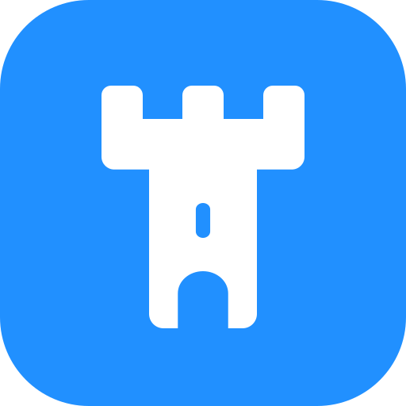

<p align="center">
  
</p>

<h1 align="center">Tower</h1>

<p align="center">
  <strong>A self-hosted device and automation mediator.</strong><br />
  Tasks, Jira tickets and merge requests in one place, and every device you own reacting to them.
</p>

<p align="center">
  <a href="LICENSE"></a>
  
  
</p>

---

## Why Tower

Your work is scattered: tasks in one tool, tickets in Jira, merge requests in Bitbucket, and a laptop, a desktop and a
server that each need to do something when one of those changes.

Tower brings them together. It follows your tools, keeps a timeline of everything that happens, and sends **events** to
the devices you connect, which run whatever you decided they should run: a notification, a deploy script, or a Claude
Code session opened on the ticket you are looking at.

Everything runs on your own server. Your devices open the connection to Tower themselves: no port to open, it works
behind any NAT.

## Features

Everything below is scoped to a **workspace**: separate *work* from *home*, each with its own data, devices and members.

- Tasks and sprints, on a board and a backlog
- Your Jira boards, as profiles narrowed by an optional JQL filter, with transitions by drag and drop
- Your Bitbucket merge requests, as a tree of stacked branches
- Events launched by hand or as quick actions
- Automation: events scheduled at intervals or at a given date, and push notifications on your phone or computer
- Webhooks for external services
- A history of everything, with what each device answered
- Members, sections and a color per workspace
- Light and dark themes, English and French

## Connection

A device joins a workspace with the **connector**: a single Python file (3.10 or later, nothing to install) that opens a
WebSocket to Tower, so no port has to be opened on the device. Its configuration, created in Tower under **Devices**,
says which events it listens to and which command to run for each:

```json
"handlers": {
  "pr.pipeline.failed": "notify-send 'Pipeline failed' '{payload.title}'",
  "deploy.*": ["git -C ~/projects/api pull", "make -C ~/projects/api deploy"]
}
```

```sh
python3 tower-connector.pyz config.json --handler tower-handler.pyz
```

Commands run without a shell, with the event as JSON on their standard input, and their result comes back to the
history. The handlers can be built in a form in Tower, which writes them into the downloaded configuration, also
available as a single-use `curl` link. Tower only triggers what a device agreed to run: it never sends a command to
execute. The optional **basic
handler** opens a Claude Code session on a Jira ticket. To run the connector as a service, see *Documentation → Linux
service* in the app.

## Getting started

Tower runs with Docker. You need Docker with Compose, and `make`.

```sh
git clone https://github.com/yonis-savary/tower.git
cd tower
cp .env.example .env
```

Edit `.env`: give a name to `COMPOSE_PROJECT_NAME`, set the database passwords and a long random `WEBSOCKET_SECRET`, and
set `UID`/`GID` to your own (`id -u`, `id -g`). Then build, generate the application key and start:

```sh
make build
docker compose -f docker-compose.yml run --rm php-fpm php do key:generate   # copy the printed key into APP_KEY
make up
docker compose -f docker-compose.yml run --rm php-fpm php do migrate:migrate
```

Open `http://localhost:8081` and create your account: your first workspace is created with it. Devices connect to the
WebSocket server on port `8088`. Both ports are set in `.env` (`TOWER_HTTP_PORT`, `TOWER_WEBSOCKET_PORT`).

In production:

- set `env=prod` in `.env`: in `debug`, an error answers with its stack trace;
- put both ports behind a TLS reverse proxy, on one domain if you like (the websocket paths are `/devices` and
  `/workspaces/<id>/devices`), which sends `X-Forwarded-Proto: https` (the session cookie is only marked `Secure` with
  it) and `Strict-Transport-Security`, and do not expose ports `8081` and `8088` publicly;
- give the proxy's address to `TOWER_WEBSOCKET_URL` (`wss://tower.example.com`) and list your public address in
  `WEBSOCKET_ALLOWED_ORIGINS`.

Later updates are a single `make deploy`.

## Development

The stack, the development commands and the architecture are described in [docs/DEVELOPMENT.md](docs/DEVELOPMENT.md).

## License

[MIT](LICENSE) © Yonis Savary
